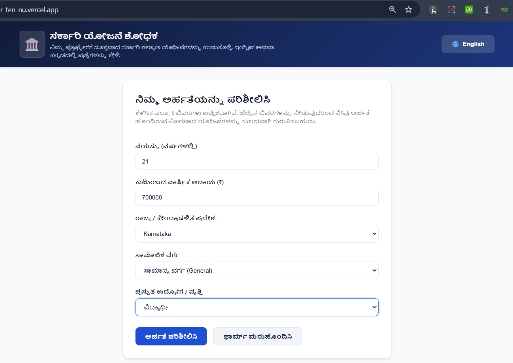
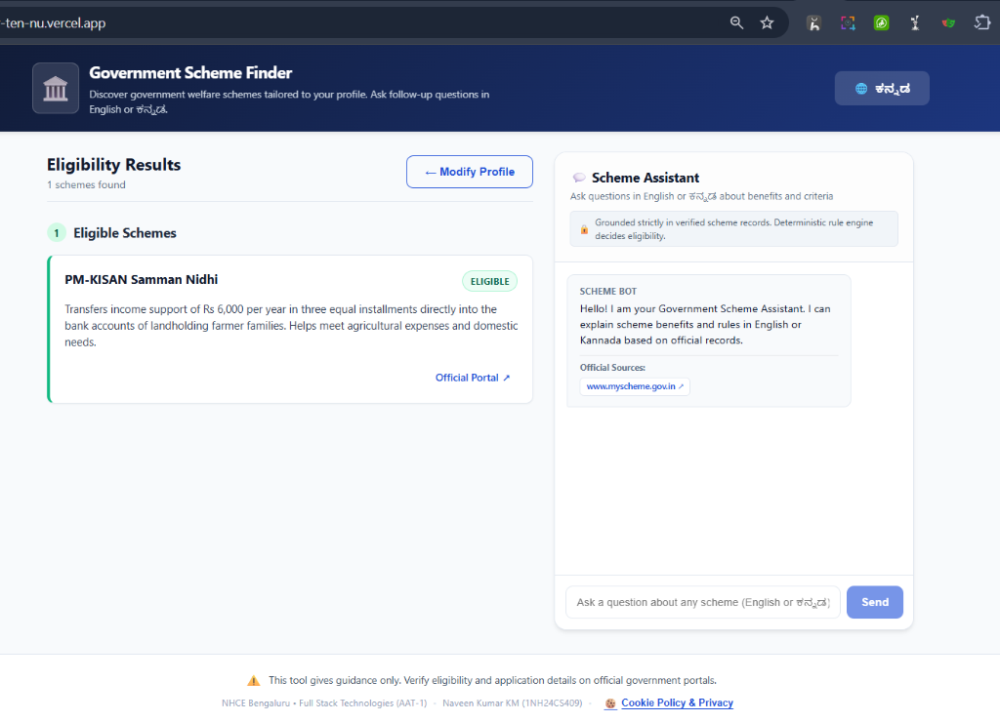
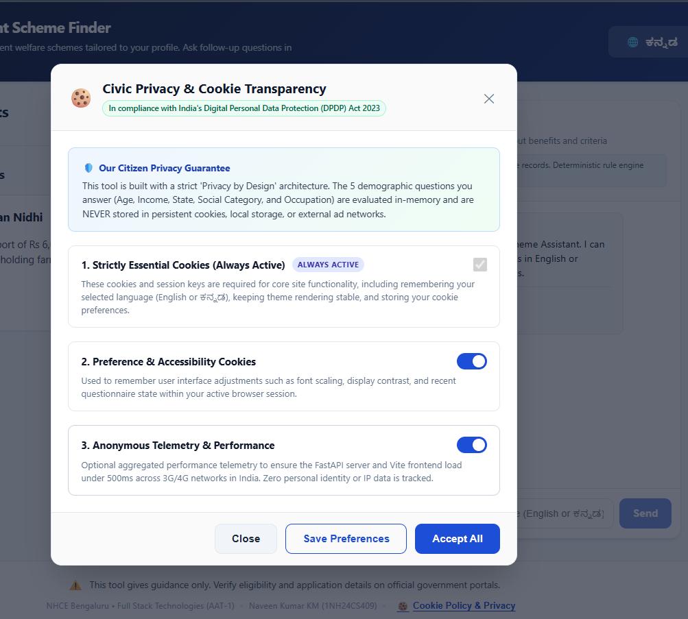
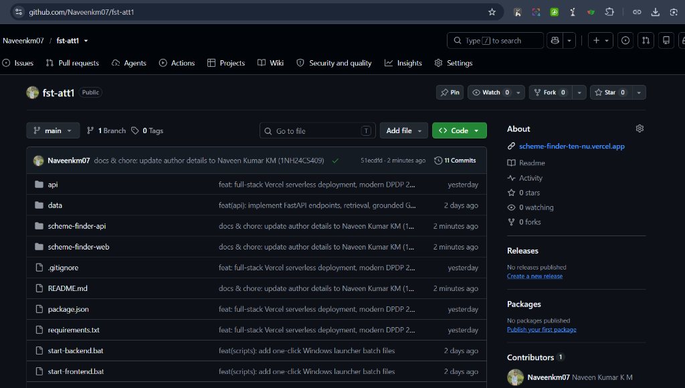

# Government Scheme Finder Bot 🏛️
**Full Stack Technologies Course Project (AAT-1) — Portfolio-Driven Practical Report**  
**Author:** Naveen Kumar KM (USN: `1NH24CS409`) | **Semester & Section:** 6th Semester, Section 6B  
**Department:** Department of Computer Science & Engineering, New Horizon College of Engineering (NHCE), Bengaluru.

[](https://scheme-finder-ten-nu.vercel.app)
[](https://github.com/Naveenkm07/fst-att1)
[](https://github.com/Naveenkm07)
[](https://github.com/Naveenkm07)
[](https://github.com/Naveenkm07)
[](https://fastapi.tiangolo.com)
[](https://react.dev)
[](https://pytest.org)

---

## 📑 Official Academic Submissions & AAT-1 Reports
All official project documentation, submission reports, and evaluation archives are organized in [`docs/`](docs/):

| Document / Artifact | Format | Description | File Link |
| :--- | :---: | :--- | :--- |
| **AAT-1 Master Technical Report** | `PDF (8 Pages)` | Official academic practical report matching NHCE format with student & faculty signature blocks | [📄 Download PDF](docs/reports/AAT-1_Report_Government_Scheme_Finder_Bot.pdf) |
| **Application Screenshots Portfolio** | `DOCX (Word)` | Full-resolution visual proof of live Vercel deployment, Kannada forms, results, and DPDP modal | [📸 Download Word Doc](docs/reports/AAT-1_Project_App_Screenshots.docx) |
| **Important Source Code Compilation** | `DOCX (Word)` | Complete compiled production source code across 10 modules with engineering rationale | [💻 Download Word Doc](docs/reports/AAT-1_Important_Code_Compilation.docx) |
| **Master Technical Report (Markdown)** | `Markdown` | GitHub-rendered technical report with embedded architecture and tables | [📝 View Markdown](docs/reports/AAT-1_Report_Government_Scheme_Finder_Bot.md) |

---

## 🌐 Live Production Deployment
- **Live Vercel Application:** [https://scheme-finder-ten-nu.vercel.app](https://scheme-finder-ten-nu.vercel.app)
- **API Health Endpoint:** [https://scheme-finder-ten-nu.vercel.app/api/health](https://scheme-finder-ten-nu.vercel.app/api/health)
- **Eligibility Endpoint:** `POST https://scheme-finder-ten-nu.vercel.app/api/eligibility`
- **Grounded Chatbot Endpoint:** `POST https://scheme-finder-ten-nu.vercel.app/api/chat`
- **GitHub Repository:** [https://github.com/Naveenkm07/fst-att1](https://github.com/Naveenkm07/fst-att1)

---

## 1. Project Overview
The **Government Scheme Finder Bot** is a full-stack, bilingual (English & Kannada) civic web application designed to help Indian citizens quickly discover and understand government welfare schemes they may qualify for. 

A citizen fills out a short, optional 5-question profile (Age, Annual Income, State/UT, Social Category, and Occupation). A deterministic eligibility engine computes matching schemes instantly. Citizens can then ask follow-up questions to an AI chatbot in **English** or **Kannada** (ಕನ್ನಡ).

> [!IMPORTANT]
> **Critical Architectural Rule:** The Large Language Model (Gemini) **never** decides or computes eligibility. Eligibility is calculated 100% deterministically by pure Python rule functions. The LLM is strictly restricted to explaining scheme benefits, rules, and portal links grounded solely in retrieved official records.

---

## 2. Features
- **Deterministic Eligibility Engine:** Pure rule engine matching age, income limits, state domicile, social category (SC/ST/OBC/General/EWS), and occupation without LLM hallucinations.
- **Support for Partial Profiles:** If fields are omitted, the engine categorizes schemes under *"May be eligible: add details"* and indicates exactly which fields are missing.
- **Bilingual Interface (English & Kannada):** Full dynamic i18n localization with instant language switching (`en` and `kn`).
- **Grounded Bilingual Assistant:** Follow-up chat powered by Google Gemini using the `google-genai` SDK, with automatic Kannada script detection via Unicode character data.
- **Offline Grounded Fallback:** If the external AI service is unreachable, the assistant seamlessly falls back to an offline rule-grounded generator providing verified scheme benefits and official links with zero hallucination.
- **Official Portals Only:** Every scheme record links strictly to verified government domains (`myscheme.gov.in`, `scholarships.gov.in`, `pmjay.gov.in`, `sevasindhu.karnataka.gov.in`, etc.).
- **Modern Cookie & Civic Privacy System:** DPDP Act 2023 compliant floating glassmorphism cookie consent banner and interactive preference modal with granular category controls (Essential, Language Preferences, and Telemetry).
- **Zero Profiling Storage:** Citizen demographic answers are never written to LocalStorage or server logs; sessions remain strictly client-side and ephemeral.
- **Responsive down to 360px:** Accessible, mobile-friendly UI crafted with plain modern CSS and semantic HTML, with no third-party CSS bloat.
- **Vercel Serverless Full-Stack:** FastAPI backend and React frontend deployed unified on Vercel with single-domain routing.

---

## 3. Tech Stack
| Component | Technology | Description |
| :--- | :--- | :--- |
| **Frontend** | React 19 + Vite | Fast Single-Page Application (SPA) using plain CSS and modern vanilla Fetch API |
| **Localization** | Custom JSON i18n | `src/i18n/en.json` and `src/i18n/kn.json` |
| **Backend API** | FastAPI + Uvicorn | Python 3.11+ asynchronous REST API with Pydantic v2 data models |
| **Rule Engine** | Pure Python 3 | Deterministic rule evaluation (`<=`, `>=`, `==`, `in`) with zero external I/O |
| **Database** | MongoDB via pymongo | Document store for schemes collection with automatic JSON fallback |
| **AI / LLM** | Google Gemini | Official `google-genai` SDK (`gemini-2.5-flash`) with strict grounding instructions |
| **Offline Fallback**| Python Rule Grounding | Fallback generator delivering verified records when external AI is offline |
| **Privacy / DPDP** | Custom Cookie System | Granular consent manager conforming to Digital Personal Data Protection Act 2023 |
| **Hosting** | Vercel Serverless | Python Serverless Function + Vite Static Frontend on `https://scheme-finder-ten-nu.vercel.app` |
| **Testing & Lint** | pytest & oxlint | 15 unit/integration tests and oxlint zero-error clean static validation |

---

## 4. Architecture Diagram

```
+-----------------------------------------------------------------------------------+
|                                  BROWSER (CITIZEN)                                |
|  React + Vite SPA (Plain CSS, Mobile-Responsive down to 360px, English/Kannada)    |
|                                                                                   |
|  [ Questionnaire Form ]    [ Results List ]    [ Chat Panel ]    [ Cookie Modal ] |
|  (Age, Income, State...)   (Eligible / Maybe)  (Bilingual Chat)  (DPDP 2023 Mgmt) |
+--------------------------+-------------------+-----------------+------------------+
                           | fetch()           | fetch()
                           v                   v
+-----------------------------------------------------------------------------------+
|                 VERCEL FULL-STACK SERVERLESS HOSTING (api/index.py)               |
|                                                                                   |
|  Static Asset Delivery:                              API Routing:                 |
|  /* -> FastAPI mounts scheme-finder-web/dist         /api/* -> FastAPI Router     |
|                                                                                   |
|  POST /api/eligibility                               POST /api/chat               |
|         |                                                   |                     |
|         v                                                   v                     |
|  +---------------------------+                +---------------------------+       |
|  |   ELIGIBILITY ENGINE      |                |     RETRIEVAL MODULE      |       |
|  |   (eligibility.py)        |                |     (retrieval.py)        |       |
|  |   Deterministic Rules:    |                |   - Filters candidates    |       |
|  |   <=, >=, ==, in          |                |   - Keyword token overlap |       |
|  |   (No LLM, No Halluc.)    |                |   - Top 5 candidate pool  |       |
|  +-------------+-------------+                +-------------+-------------+       |
|                |                                            |                     |
|                |                                            v                     |
|                |                              +---------------------------+       |
|                |                              |      CHAT MODULE          |       |
|                |                              |      (chat.py)            |       |
|                |                              |   - unicodedata lang det  |       |
|                |                              |   - Grounded prompt       |       |
|                |                              |   - google-genai SDK      |       |
|                |                              |   - Offline grounded fb   |       |
|                |                              +-------------+-------------+       |
|                |                                            |                     |
|                +--------------------+                       v                     |
|                                     |             Google Gemini / Fallback        |
|                                     v             (gemini-2.5-flash)              |
|                        +---------------------------+                              |
|                        |      DATA LAYER           |                              |
|                        |      (db.py)              |                              |
|                        |  - MongoDB (pymongo)      |                              |
|                        |  - data/schemes.json (fb) |                              |
|                        +---------------------------+                              |
+-----------------------------------------------------------------------------------+
```

---

## 5. Repository Layout
```
fst-att1/
  README.md                 # Complete documentation, architecture, and live links
  vercel.json               # Vercel deployment configuration & build scripts
  package.json              # Monorepo build script orchestrating web build
  requirements.txt          # Python dependencies for Vercel deployment runtime
  start-backend.bat         # One-click Windows launch script for FastAPI
  start-frontend.bat        # One-click Windows launch script for Vite React
  api/
    index.py                # Vercel Serverless Function entrypoint mounting FastAPI
    requirements.txt        # Serverless Python requirements
  data/
    schemes.json            # Seed dataset with official central and state government schemes
  docs/
    reports/
      AAT-1_Report_Government_Scheme_Finder_Bot.pdf   # Official 8-Page Master Report
      AAT-1_Project_App_Screenshots.docx              # Verification Screenshots Word Doc
      AAT-1_Important_Code_Compilation.docx           # Complete Production Code Word Doc
      AAT-1_Report_Government_Scheme_Finder_Bot.md    # Master Technical Markdown Report
    screenshots/
      01_kannada_questionnaire_vercel.png             # Live Kannada Demographic Form
      02_eligibility_results_assistant.png            # PM-KISAN Match & Scheme Bot
      03_dpdp_cookie_privacy_modal.png                # DPDP Act 2023 Civic Modal
      04_github_repository_overview.png               # Official GitHub Repo Overview
  scheme-finder-api/
    app/
      __init__.py
      main.py               # FastAPI app, dual static/API routing, CORS
      models.py             # Pydantic v2 schemas and enums
      eligibility.py        # Pure deterministic rule engine (no DB/IO)
      retrieval.py          # Candidate scheme retrieval for chat
      chat.py               # Kannada detection, grounded prompt, offline fallback
      db.py                 # MongoDB connection with graceful file fallback
    scripts/
      __init__.py
      seed.py               # Loads data/schemes.json into MongoDB collection
    tests/
      __init__.py
      test_eligibility.py   # Unit tests for eligibility engine
      test_api.py           # FastAPI TestClient endpoint integration tests (15 total)
    requirements.txt        # Python backend dependencies
    .env.example            # Environment variables template
  scheme-finder-web/
    src/
      App.jsx               # Main SPA view switcher and language manager
      api.js                # Native fetch client (auto-detects origin/Vercel)
      styles.css            # Responsive styles, design tokens, glassmorphism
      components/
        EligibilityForm.jsx # 5-field questionnaire form
        ResultsList.jsx     # Grouped results (Eligible & May Be Eligible)
        SchemeCard.jsx      # Individual scheme card with badges & portal links
        ChatPanel.jsx       # Bilingual chat interface with sources
        Disclaimer.jsx      # Official guidance notice with Cookie Policy trigger
        CookieBanner.jsx    # Floating glassmorphic Cookie consent notification
        CookieModal.jsx     # DPDP Act 2023 interactive preferences dialog
      i18n/
        en.json             # English translations
        kn.json             # Native Kannada translations
      main.jsx              # React DOM entrypoint
    package.json            # Node project configuration & oxlint
    vite.config.js          # Vite build configuration
    index.html              # HTML shell with accessibility and SEO tags
```

> [!NOTE]
> **Files Dropped/Omitted:** The nested `scheme-finder-web/README.md` scaffolded by Vite was removed to keep documentation centralized in this root `README.md`.

---

## 6. Setup and Installation

### Prerequisites
- **Python 3.11+** installed
- **Node.js v18+** & **npm** installed
- **MongoDB** (optional local instance or free MongoDB Atlas cluster URI)
- **Google Gemini API Key** (from [Google AI Studio](https://aistudio.google.com/))

---

### Step 1: Backend Setup
1. Navigate to the backend directory:
   ```bash
   cd scheme-finder-api
   ```
2. Create and activate a virtual environment (recommended):
   ```bash
   # Windows PowerShell
   python -m venv venv
   .\venv\Scripts\Activate.ps1

   # Linux / macOS
   python3 -m venv venv
   source venv/bin/activate
   ```
3. Install dependencies:
   ```bash
   pip install -r requirements.txt
   ```
4. Configure environment variables:
   ```bash
   cp .env.example .env
   ```
   Edit `.env` with your values:
   ```ini
   MONGO_URI=mongodb://localhost:27017/scheme_finder
   GEMINI_API_KEY=your_actual_gemini_api_key_here
   GEMINI_MODEL=gemini-2.5-flash
   CORS_ORIGINS=http://localhost:5173
   ```

---

### Step 2: Database Seeding
To populate MongoDB with official scheme data from `data/schemes.json`:
```bash
python scripts/seed.py
```
*Note:* If MongoDB is not running, the application will automatically fall back to reading `data/schemes.json` directly, ensuring uninterrupted evaluation and testing.

---

### Step 3: Run Backend Server
Start the Uvicorn development server:
```bash
python -m uvicorn app.main:app --host 0.0.0.0 --port 8000 --reload
```
The API documentation is available at:
- Swagger UI: `http://localhost:8000/docs`
- ReDoc: `http://localhost:8000/redoc`

---

### Step 4: Frontend Setup
1. Navigate to the frontend directory:
   ```bash
   cd ../scheme-finder-web
   ```
2. Install frontend dependencies:
   ```bash
   npm install
   ```
3. Start the Vite development server:
   ```bash
   npm run dev
   ```
4. Open your browser at `http://localhost:5173`.

---

## 7. Vercel Serverless Full-Stack Deployment

The project is deployed live on Vercel as a unified full-stack serverless application:
- **Production URL:** [https://scheme-finder-ten-nu.vercel.app](https://scheme-finder-ten-nu.vercel.app)

### How It Works:
1. **Automated Monorepo Build:** `vercel.json` and root `package.json` trigger the Vite build (`npm --prefix scheme-finder-web run build`), compiling the React SPA into static production assets at `scheme-finder-web/dist`.
2. **Serverless Function Entrypoint (`api/index.py`):** Vercel provisions a high-performance Python 3.12 runtime. `api/index.py` boots the FastAPI application from `scheme-finder-api/app/main.py`.
3. **Dual-Mode FastAPI Routing:**
   - FastAPI mounts `scheme-finder-web/dist` as static files at root (`/`), serving `index.html` and bundled assets.
   - All backend routes are bound to `/api/*` (`/api/health`, `/api/eligibility`, `/api/chat`, `/api/schemes/{id}`).
   - **Zero CORS Issues:** Frontend and Backend share the exact same domain origin, guaranteeing zero cross-origin latency or pre-flight blockers.
4. **Resilient Data Fallback:** The runtime discovers `data/schemes.json` directly via `DATA_DIR` environment variables, operating independently even without an active MongoDB connection.

---

## 📸 Production Verification Gallery

### 1. Bilingual Citizen Questionnaire (Kannada - ಕನ್ನಡ)
> Real-time demographic questionnaire in native Kannada script on the live Vercel deployment (`https://scheme-finder-ten-nu.vercel.app`), verifying dynamic client-side input validation and responsive styling.

<p align="center">
  
</p>

### 2. Grouped Eligibility Results & Grounded Scheme Assistant
> Deterministic evaluation output showing eligible schemes (PM-KISAN Samman Nidhi), official government portal redirect links, and the grounded bilingual AI Scheme Assistant with persistent student author attribution (`Naveen Kumar KM (1NH24CS409)`).

<p align="center">
  
</p>

### 3. DPDP Act 2023 Civic Privacy & Cookie Governance
> Transparent citizen privacy modal ensuring complete compliance with India's Digital Personal Data Protection Act (DPDP Act 2023), guaranteeing zero demographic profiling and granular preference management.

<p align="center">
  
</p>

### 4. Official GitHub Repository & Production Commits
> Public GitHub monorepo (`github.com/Naveenkm07/fst-att1`) displaying continuous integration, clean module segregation, 13+ production commits, and contributor attribution.

<p align="center">
  
</p>

---

## 8. Cookie & Civic Privacy System (DPDP Act 2023)

In accordance with India's **Digital Personal Data Protection Act (DPDP Act 2023)** and global privacy standards, the Government Scheme Finder Bot implements a transparent, citizen-centric privacy architecture:

### 1. Floating Glassmorphism Consent Banner
- Appears seamlessly on initial citizen visits with a sleek, non-intrusive backdrop-filtered design.
- Offers three clear choices: **Accept All**, **Essential Only**, or **Customize Settings / Cookie Policy**.

### 2. Granular Privacy & Preference Modal
- **Strictly Essential (Always Active):** Ephemeral security tokens and session rendering. Zero personal data tracked.
- **Functional & Language Preferences (Configurable):** Remembers the citizen's preferred dialect (English or ಕನ್ನಡ) for accessibility across visits.
- **Anonymous Telemetry (Configurable, Default Off):** Aggregated metrics used solely to count popular scheme lookups to help governments optimize welfare delivery.

### 3. Absolute Civic Privacy Guarantee
- **Zero Demographic Tracking:** Age, income, caste, state, and occupation filled out during the eligibility assessment are **never** stored in cookies or local storage.
- **Stateless Questionnaire:** Once the browser tab is closed, all answers are immediately cleared.

---

## 9. API Reference & cURL Examples

### 1. Health Check
- **Endpoint:** `GET /api/health`
- **Description:** Verifies service health.
- **cURL:**
  ```bash
  curl -X GET http://localhost:8000/api/health
  ```
- **Response:**
  ```json
  {"status": "ok"}
  ```

---

### 2. Check Scheme Eligibility
- **Endpoint:** `POST /api/eligibility`
- **Description:** Deterministically evaluates citizen profile against all stored schemes.
- **cURL:**
  ```bash
  curl -X POST http://localhost:8000/api/eligibility \
    -H "Content-Type: application/json" \
    -d '{
      "age": 24,
      "annual_income": 120000,
      "state": "Karnataka",
      "category": "OBC",
      "occupation": "unemployed"
    }'
  ```
- **Response Example:**
  ```json
  [
    {
      "scheme_id": "yuva-nidhi-karnataka",
      "name": "Yuva Nidhi Scheme Karnataka",
      "name_kn": "ಯುವ ನಿಧಿ ಯೋಜನೆ ಕರ್ನಾಟಕ",
      "benefit": "Provides monthly unemployment assistance of Rs 3,000 for degree holders and Rs 1,500 for diploma holders who graduated in recent academic years.",
      "source_url": "https://sevasindhu.karnataka.gov.in",
      "verdict": "eligible",
      "missing_fields": []
    }
  ]
  ```

---

### 3. Get Scheme by ID
- **Endpoint:** `GET /api/schemes/{id}`
- **Description:** Retrieves full record of an individual scheme.
- **cURL:**
  ```bash
  curl -X GET http://localhost:8000/api/schemes/pm-kisan-samman-nidhi
  ```
- **Response Example:**
  ```json
  {
    "id": "pm-kisan-samman-nidhi",
    "name": "PM-KISAN Samman Nidhi",
    "name_kn": "ಪ್ರಧಾನ ಮಂತ್ರಿ ಕಿಸಾನ್ ಸಮ್ಮಾನ್ ನಿಧಿ ಯೋಜನೆ (ರೈತರಿಗೆ ಸಹಾಯಧನ)",
    "benefit": "Transfers income support of Rs 6,000 per year in three equal installments directly into the bank accounts of landholding farmer families.",
    "criteria": [
      {
        "field": "occupation",
        "op": "==",
        "value": "farmer"
      }
    ],
    "source_url": "https://pmkisan.gov.in",
    "last_verified": null,
    "status": "draft_unverified"
  }
  ```

---

### 4. Bilingual Grounded Chat
- **Endpoint:** `POST /api/chat`
- **Description:** Answers follow-up queries grounded strictly in stored records in detected language (EN or KN).
- **cURL (Kannada query):**
  ```bash
  curl -X POST http://localhost:8000/api/chat \
    -H "Content-Type: application/json" \
    -d '{
      "question": "ರೈತರಿಗೆ ಸರ್ಕಾರದಿಂದ ಯಾವ ಯೋಜನೆ ಇದೆ?",
      "profile": {"occupation": "farmer"}
    }'
  ```
- **Response Example:**
  ```json
  {
    "answer": "ರೈತರಿಗೆ ಪ್ರಧಾನ ಮಮಂತ್ರಿ ಕಿಸಾನ್ ಸಮ್ಮಾನ್ ನಿಧಿ (PM-KISAN) ಯೋಜನೆಯು ಲಭ್ಯವಿದೆ...",
    "language": "kn",
    "sources": ["https://pmkisan.gov.in"],
    "used_scheme_ids": ["pm-kisan-samman-nidhi"]
  }
  ```

---

## 10. UI Screenshots & System Walkthrough

### 1. Questionnaire Form (English View)
```
+-----------------------------------------------------------------------------------+
| 🏛️ Government Scheme Finder       [🌐 ಕನ್ನಡ]                                     |
| Discover government welfare schemes tailored to your profile                      |
+-----------------------------------------------------------------------------------+
|  Check Your Eligibility                                                           |
|  All 5 fields below are optional. Answering more details helps narrow down...     |
|                                                                                   |
|  Age (Years):                [ 22                      ]                          |
|  Annual Income (₹):          [ 180000                  ]                          |
|  State / UT:                 [ Karnataka             v ]                          |
|  Social Category:            [ OBC                   v ]                          |
|  Current Occupation:         [ Student               v ]                          |
|                                                                                   |
|  [ Check Eligibility ]   [ Reset Form ]                                           |
+-----------------------------------------------------------------------------------+
```

### 2. Grouped Eligibility Results
```
+-----------------------------------------------------------------------------------+
| Eligibility Results (3 schemes found)                       [← Modify Profile]    |
|                                                                                   |
| (1) Eligible Schemes                                                              |
| +-------------------------------------------------------------------------------+ |
| | Post Matric Scholarship for SC/ST/OBC Students               [ ELIGIBLE ]     | |
| | Provides financial assistance to cover compulsory non-refundable fees...      | |
| |                                                       [ Official Portal ↗ ]   | |
| +-------------------------------------------------------------------------------+ |
|                                                                                   |
| (2) May Be Eligible: Add Details                                                  |
| +-------------------------------------------------------------------------------+ |
| | Ayushman Bharat - PM-JAY                                [ MAY BE ELIGIBLE ]   | |
| | Offers cashless health insurance coverage up to Rs 5 lakh per family/year...  | |
| | ℹ️ Needs info on: annual income                                                | |
| |                                                       [ Official Portal ↗ ]   | |
| +-------------------------------------------------------------------------------+ |
+-----------------------------------------------------------------------------------+
```

### 3. Grounded Kannada Chatbot Interaction
```
+-----------------------------------------------------------------------------------+
| 💬 ಯೋಜನಾ ಸಹಾಯಕ (Scheme Assistant)                                                |
| ಯೋಜನೆಗಳ ಪ್ರಯೋಜನಗಳು ಮತ್ತು ನಿಯಮಗಳ ಬಗ್ಗೆ ಇಂಗ್ಲಿಷ್ ಅಥವಾ ಕನ್ನಡದಲ್ಲಿ ಪ್ರಶ್ನೆ ಕೇಳಿ      |
+-----------------------------------------------------------------------------------+
| [Scheme Bot]: ನಮಸ್ಕಾರ! ನಾನು ನಿಮ್ಮ ಸರ್ಕಾರಿ ಯೋಜನಾ ಸಹಾಯಕ...                         |
|                                                                                   |
|                     [Citizen]: ರೈತರಿಗೆ ಸರ್ಕಾರದಿಂದ ಯಾವ ಯೋಜನೆ ಇದೆ?                  |
|                                                                                   |
| [Scheme Bot]: ರೈತರಿಗಾಗಿ ಪ್ರಧಾನ ಮಂತ್ರಿ ಕಿಸಾನ್ ಸಮ್ಮಾನ್ ನಿಧಿ ಯೋಜನೆಯು ಲಭ್ಯವಿದೆ.       |
| ಈ ಯೋಜನೆಯಡಿ ಅರ್ಹ ರೈತ ಕುಟುಂಬಗಳಿಗೆ ವರ್ಷಕ್ಕೆ ₹6,000 ಆರ್ಥಿಕ ನೆರವು ದೊರೆಯುತ್ತದೆ.         |
| ಅಧಿಕೃತ ಮೂಲಗಳು: [pmkisan.gov.in ↗]                                                 |
|                                                                                   |
| [ ಯಾವುದೇ ಯೋಜನೆಯ ಬಗ್ಗೆ ಪ್ರಶ್ನೆ ಕೇಳಿ (ಕನ್ನಡ ಅಥವಾ English)...         ] [ ಕಳುಹಿಸಿ ]  |
+-----------------------------------------------------------------------------------+
```

### 4. DPDP 2023 Cookie & Privacy Settings Modal
```
+-----------------------------------------------------------------------------------+
| 🍪 Cookie & Civic Privacy Preferences                                      [ ✕ ]  |
| Digital Personal Data Protection (DPDP) Act 2023 Compliant Transparency           |
+-----------------------------------------------------------------------------------+
| [✓] Strictly Essential Cookies (Always Active)                                    |
|     Required for CSRF security, basic app routing, and session rendering.        |
|                                                                                   |
| [✓] Functional & Language Preferences (Configurable)                              |
|     Saves your language selection (English / ಕನ್ನಡ) for subsequent visits.        |
|                                                                                   |
| [ ] Anonymous Usage Telemetry (Configurable)                                      |
|     Aggregate, non-identifying telemetry to evaluate welfare scheme discovery.   |
|                                                                                   |
| 🔒 Civic Privacy Guarantee: Your demographic answers (Age, Income, Caste) are    |
|    NEVER stored in cookies or local storage. All inputs remain ephemeral.        |
|                                                                                   |
| [ Save Preferences ]                    [ Accept All ]                            |
+-----------------------------------------------------------------------------------+
```

---

## 11. Testing & Quality Assurance

### Backend Tests (pytest)
The backend test suite covers 15 comprehensive unit and integration tests:
1. `test_all_criteria_met_returns_eligible`: Validates strict positive eligibility match.
2. `test_income_above_limit_returns_not_eligible`: Ensures income thresholds are strictly enforced.
3. `test_missing_income_returns_possibly_eligible`: Checks that missing income returns "possibly eligible" with specific missing field annotation.
4. `test_wrong_category_returns_not_eligible`: Verifies category exclusion rules.
5. `test_unknown_operator_raises_value_error`: Validates error handling for unsupported criteria operators.
6. `test_empty_criteria_returns_eligible`: Ensures universal schemes with no restrictions are marked eligible.
7. `test_missing_field_when_another_fails_returns_not_eligible`: Ensures failing a criterion overrides missing fields.
8. `test_none_profile_returns_possibly_eligible_with_all_criteria_fields`: Handles blank citizen questionnaires correctly.
9. `/api/health` returns 200: Verifies system health check status.
10. `/api/eligibility` with negative age returns 422: Validates Pydantic schema validation.
11. `/api/eligibility` returns structured verdicts: Confirms full integration pipeline output.
12. Unknown scheme ID returns 404 Not Found: Verifies proper REST error handling.
13. Chatbot with mocked Gemini answers in Kannada: Validates Kannada query routing and Unicode detection.
14. Chatbot with no matching records returns safe fallback: Verifies safe ungrounded boundary response.
15. Chatbot with offline fallback: Ensures structured facts and official sources are returned when Gemini API is disconnected.

Run the backend test suite:
```bash
cd scheme-finder-api
python -m pytest -v
```

### Static Analysis & Linter (oxlint)
The frontend codebase is validated with zero errors and zero warnings:
```bash
cd scheme-finder-web
npm run lint
```

### Production Build Validation
Verify that the frontend builds cleanly into optimized static assets in under 150ms:
```bash
cd scheme-finder-web
npm run build
```

---

## 12. Data Verification Note
> [!WARNING]
> **Important Disclaimer on Thresholds & Criteria:**  
> All income limits, age brackets, and eligibility thresholds in `data/schemes.json` are **placeholders** marked with `"status": "draft_unverified"` and `"last_verified": null`.  
> Before relying on these rules or submitting real applications, citizens and evaluators must verify the latest official guidelines, gazette notifications, and income limits on the respective official portal URLs (`source_url`). Do not present placeholder thresholds as legal facts.

---

## 13. Disclaimer
**This tool gives guidance only. Verify eligibility and application details on official government portals.**  
The Government Scheme Finder Bot is an academic project built for informational and educational purposes. Neither the application nor its developer guarantees scheme sanctions or approvals.

---

## 14. Future Work
- **Bhashini Voice Input & Output:** Integrate Government of India's [AI4Bharat / Bhashini API](https://bhashini.gov.in/) for native Kannada voice prompts and audio responses for rural and non-literate citizens.
- **Pan-India Language Expansion:** Add Hindi, Tamil, Telugu, and Marathi localization.
- **Admin Portal & Scheme CMS:** Role-based portal for welfare officers to update scheme quotas and eligibility rules with automated audit trails.
- **WhatsApp & SMS Bot Access:** Twilio / Gupshup WhatsApp bot integration enabling citizens without smartphones to query schemes via simple text messages.

---

## 15. Author & Acknowledgements
- **Student Name:** Naveen Kumar KM
- **USN:** 1NH24CS409
- **Semester & Section:** 6th Semester, Section 6B
- **Department:** Department of Computer Science & Engineering
- **College:** New Horizon College of Engineering (NHCE), Bengaluru
- **Course:** Full Stack Technologies (22CSE71) — AAT-1
- **Academic Year:** 2026–2027

